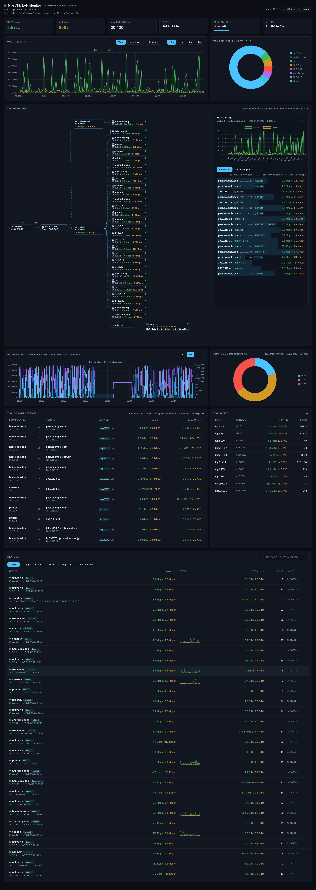

# MikroTik LAN Monitor

A lightweight, self-hosted web dashboard for MikroTik routers (RouterOS v6/v7) — live per-device traffic, a network map, and WiFi client insight.



## Features

- **Live per-device traffic**: real-time download/upload charts, current speed, cumulative totals, 15m–24h history, sparklines, search/sort
- **Network map**: devices grouped by router port, busiest-first, with router identity, board name and RouterOS version
- **Live flows**: who each device is talking to right now (rate, service, conns, reverse-DNS) plus an "Accessing you" tab for inbound callers
- **Traffic analytics**: active flows/hosts history, protocol distribution, top ports, top conversations (ntpng-style)
- **Router extras**: hardware sensors (temperature/voltage), DHCP pool usage, per-device internet pause/resume (opt-in)
- **Router profiles**: switch between several routers in the browser; each keeps its own history
- Survives a busy router gracefully — keeps last known data instead of going blank
- Multi-arch image (`amd64` + `arm64`): runs on x86 boxes, Raspberry Pi, RK3588 SBCs and NAS

## Quick start

```sh
curl -O https://raw.githubusercontent.com/AngusLearn/mikrotik-dashboard/main/docker-compose.public.yml
mkdir -p data
docker compose -f docker-compose.public.yml up -d
```

Open http://localhost:8899 and click **Enter credentials** — the dashboard stores them itself (chmod 600), so no config file editing.

Or with plain `docker run`:

```sh
docker run -d --name mikrotik-dashboard \
  -p 8899:8899 -v ./data:/data \
  anguslearn/mikrotik-dashboard:latest
```

| | |
|---|---|
| UI port | `8899` |
| Data volume | `/data` (config, auth hash, per-router history DBs) |
| Requirement | RouterOS API reachable on port `8728` |

## Tags

- `latest` — current `main` branch
- `<full-commit-sha>` — pinned to a commit

Source, docs and issues: [github.com/AngusLearn/mikrotik-dashboard](https://github.com/AngusLearn/mikrotik-dashboard)
