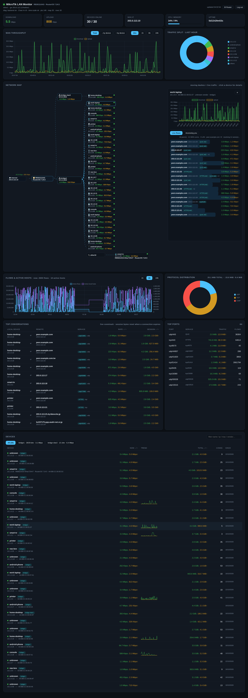

# MikroTik LAN Monitor



Live per-device traffic dashboard for a MikroTik router (RouterOS v6/v7).
Dark web UI with: live download/upload charts, per-device real-time speed,
cumulative totals, 15m–24h history, search/sort, sparklines, and optional
one-click internet pause/resume per device (off by default). Device names come
from DHCP leases and ARP, with **MikroTik Neighbor Discovery** identity as a
fallback — so Mikrotik APs/switches without DHCP leases still show by their
router identity, together with their **board name** (the CLI `BOARD` column,
e.g. `RB962UiGS-5HacT2HnT`) and **RouterOS firmware
version** (e.g. `RouterOS 7.24.5` in the row, the detail panel **and the network
map node**); the same box
seen under several MACs (radio vs bridge) is merged into one device. Click a device and
a **detail panel** docks beside the network map (stacks below it on narrow
screens, grows to the map's height and your screen height; close with ✕ or **Esc**): its 1-hour chart, identity, and pause/resume.
The panel's **Live flows** list
shows who it is talking to right now (per remote IP: rate, service, conns,
reverse-DNS name) with a separate **Accessing you** tab for inbound callers.
In the network map, devices stay ordered
busiest-first and **glide to their new row** when the traffic order changes
(~0.4 s; nothing jumps, and it stays still if your OS asks for reduced motion).
The map header's **⇅ Speed / ⇅ IP** button switches device ordering between
live rate (default) and ascending IP address; the choice is remembered per
browser and applies inside each network/port group.
Below the map, **traffic analytics** panels give an ntopng-style overview:
active-flows & active-hosts history (1h/6h/24h), exact traffic volume +
protocol distribution for the range, top ports by traffic, and a live
**Top conversations** table of every local ⇄ remote conversation right now.

## Files
| file | purpose |
|---|---|
| `server.py` | backend (Python + FastAPI, talks RouterOS API on port 8728) |
| `static/` | dashboard UI (works fully offline, Chart.js bundled) |
| `config.json` | your router address + login — **created when you save credentials in the web UI** (stored chmod 600) |
| `auth.json` | web login password (hash only) — **only exists if you enabled login**, chmod 600 |
| `history.db` | traffic history (SQLite, auto-pruned after `retention_hours`) |
| `start.bat` | Windows one-click launcher |

## Quick start
1. Install Python from python.org if you don't have it (tick **"Add python.exe to PATH"**).
2. Double-click `start.bat`. Your browser opens http://localhost:8899
   (Windows may ask once to allow Python on private networks → Allow).
3. The dashboard shows an orange banner → click **Enter credentials** and fill:
   - Router IP: `192.168.88.1` is the MikroTik factory default; many networks
     use `192.168.1.1` / `10.0.0.1` instead — whatever Winbox shows top-left
   - Username / password — see below for the recommended safe way.

Switching to a different router (or a different router account) is done in
the browser too: header **⚙ Router** opens the **Router profiles** dialog —
saved routers are listed with the active one marked *connected*; **Switch**
on any other row reconnects instantly with its stored password (no retyping).
New routers or changed credentials go in the separate **Add / update router**
form below (**Save & connect** stores them under the router's IP); **Delete**
removes a profile (deleting the active one brings back the Enter-credentials
banner). Close with ✕ or Esc. Your dashboard login and history stay untouched
either way, and no restart is needed. Each profile keeps **its own traffic
history** (`history-<profile>.db`) — charts never mix two routers' data.

## Running in Docker (e.g. a Raspberry Pi)

Fastest path on any SBC/NAS — pulls the published image, port 8899 pre-mapped:

```bash
curl -O https://raw.githubusercontent.com/AngusLearn/mikrotik-dashboard/main/docker-compose.public.yml
mkdir -p data
docker compose -f docker-compose.public.yml up -d
```

Measured footprint: ~50-60 MB RAM, a few % CPU, image 141 MB (mostly the
Python base). Runs fine on a Pi Zero 2 W; any 64-bit Pi OS works
(`librouteros` is pure Python, `pydantic` ships arm64 wheels).

```bash
git clone <this repo> && cd mikrotik-dashboard
mkdir -p data
docker compose up -d --build        # or: podman-compose up -d --build
# open http://<pi-ip>:8899 -> first-run setup wizard sets the login password,
# then add your routers in the UI. To reuse an existing install instead,
# copy config.json + auth.json into data/ before starting.
```

All state (config, login, per-profile history) lives in `./data` (mounted at
`/data`, `$DASH_BASE`); the image itself is disposable. Charts/JS are vendored,
so the browser needs no internet; vendor-name lookups (OUI) download once when
the container has internet and are skipped gracefully offline. On a Pi, consider
`interval_seconds: 30` and a modest `retention_hours` to keep SD-card writes low.

## ⚠️ Persist your settings: `/data` must be a stable bind mount

Everything the dashboard stores — the webUI login, router profiles, and all
history — lives in the container's `/data`. Run **without** a `-v` mount (or
with an *anonymous* volume) and every container recreate (Portainer
"recreate", image updates) deletes the setup: you re-enter the webUI password
and all router credentials. Always bind one fixed host folder:

```bash
mkdir -p /home/me/mtdash-data          # pick any path, then never change it
# docker run:  -v /home/me/mtdash-data:/data
# compose:     volumes: [ /home/me/mtdash-data:/data ]
```

Portainer users: prefer a **Stack** with the compose file; for a hand-built
container use volume type **bind** with host path → `/data`. Verify after any
recreate: `docker inspect -f '{{json .Mounts}}' mikrotik-dashboard` must list
your host path mounted at `/data`. The folder grows `auth.json`, `config.json`
and `history-*.db` — back it up and the entire setup restores on any host.

## WiFi / AP monitoring

When the monitored device is an access point (or has WiFi enabled), the
dashboard shows its wireless clients: the header counts associated stations,
device rows and map nodes carry a `📶 SSID −signal dBm` line, and the device
panel shows SSID, band, radio chipset, live signal, PHY link rate and online
time. Switch to your AP's profile (⚙ Router) to see who is connected over
WiFi and how. Works with both RouterOS WiFi stacks.

## Recommended: create a read-only router login (do this once in Winbox)
Don't give the dashboard your admin account. RouterOS supports read-only users:
1. Winbox → **Users** tab → click **Groups** → `+`
   - Name: `monitor`
   - Policies: tick **read** and **test** only. OK.
2. **Users** tab → `+`
   - Name: `monitor` (or whatever you like), Password: any.
   - Group: `monitor`. OK.
That user can see everything but cannot change router settings — worst case
if the password ever leaks, nobody can touch your router config.

## Router side checklist (usually nothing to do)
- API service must be enabled: Winbox → **IP → Services** → `api` (port 8728) should be present. It is enabled by default on most setups.
- Ports used: dashboard listens on `8899` on your PC; router API `8728`.

## Login password (Pi-hole style — the dashboard is never served unauthenticated)
**First time**: open the dashboard and a **setup wizard** asks you to create the
login password (min 8 chars, typed twice). Whoever reaches the wizard first on
a shared LAN claims the account — start fresh installs promptly; the server logs
the IP that completed setup. For Docker: expose the port only after the first
boot, or set the password non-interactively before serving (see below).

**Forgot it?** Run on the machine hosting the dashboard:

```bash
venv/bin/python server.py --passwd         # RESET the password (works while running)
venv/bin/python server.py --passwd-stdin   # non-interactive (echo pw | ...)
venv/bin/python server.py --no-passwd      # remove account -> wizard runs again next visit
```

`--passwd` is the `pihole -a -p` equivalent: console access is the proof of
ownership; it revokes all sessions and clears lockouts. Only a PBKDF2-SHA256
hash (240k iterations, random salt) is stored in `auth.json`; browsers get an
HttpOnly session cookie valid 12 h of activity (sessions survive restarts), and
10 wrong passwords lock an IP out for 5 minutes (also restart-proof). Corrupt
`auth.json` fails CLOSED — the gate never opens by accident.
For containers: keep `config.json`, `auth.json` and `history.db` on a mounted
volume (the app honors `DASH_BASE` to relocate them and `--port` to move
the listen port). The automated browser suites authenticate automatically with
`DASH_TEST_PW` (default `pytest-dash-12345`) — export it if you set your own.

## config.json (auto-created by the web UI, or edit by hand)
```json
{
  "host": "192.168.1.1",
  "port": 8728,
  "user": "monitor",
  "password": "your-monitor-password",
  "interval_seconds": 3,
  "retention_hours": 48,
  "allow_control": false
}
```
- `interval_seconds` — sampling rate (3 s is fine for a home router)
- `retention_hours` — how long history charts go back
- `allow_control` — `true` enables the red **Pause internet / Resume** buttons
  (adds one firewall rule `mikrotik-dash` + address-list `DASH_BLOCKED`;
  fully removed again when you set it back to false and delete the rule).

## How per-device traffic is measured
- WAN totals: exact, from router interface byte counters.
- Per device: live estimate aggregated from the router's connection table
  (per-session rates), accumulated over time into per-device totals.
  No router config changes needed. For bit-exact per-device accounting,
  enable Torch (NetFlow) — possible as a future upgrade.

## The Live flows list — what it can and cannot tell you
Click any device: the detail panel lists the remote IPs it currently has connections
to, with rate, service (`HTTPS:443`, `QUIC:443`, `WireGuard:51820`…), connection count and
a name. `Accessing you` shows only the ones that *initiated* toward the device
(port-forwards show up here). Two honest limits:

- **Current connections only.** It reads the router's live connection table, so
  a connection that started and finished between two polls is invisible, and
  entries disappear after their protocol timeout. It answers "what is it
  talking to *now*", not "what did it touch at 03:00" (that would need Torch /
  NetFlow on the router).
- **IPs and ports only, names added afterwards.** There are no domain names in
  the connection table. Names come from the router's DNS cache when it happens
  to have the answer, otherwise from reverse DNS. No ASN or country data is
  shown: RouterOS does not ship an IP-geo database for the API.

## Data & privacy
Everything runs on your LAN. The only external download (once, optional) is
the Wireshark MAC-vendor list for showing device vendors; the dashboard works
without internet. One exception worth knowing: naming peers uses **reverse DNS**
queries (your configured resolver sees the remote IPs being looked up), and
they only run for devices whose detail panel you actually open. If you would rather
nothing leave the network, that lookup can be switched off — say the word.
